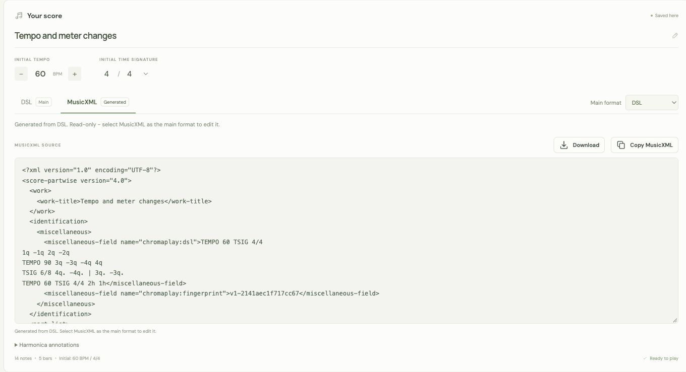
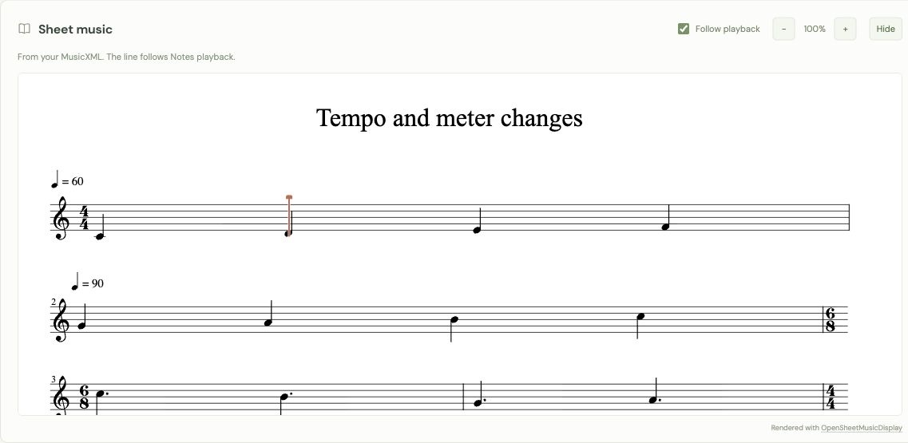

# ChromaPlay

A browser app for practicing a 12-hole chromatic harmonica. Write a melody in simple text, hear it played back, and follow the falling notes. Add your own backing track or play the on-screen harmonica with your mouse and keyboard.

**[Open ChromaPlay](https://alirezaroshanzamir.github.io/chromaplay/)**


Follow the falling notes or play the harmonica directly with your mouse and keyboard.

## Features

- A simple notation language for holes, blow/draw, the slider, note lengths, and rests.
- An inline score editor with duration-sized note boxes, breath colors, and a moving playhead.
- DSL and MusicXML tabs, with one editable main format and an automatically converted view of the other.
- Optional sheet image and PDF recognition through the public LEGATO demo, with MusicXML download and import.
- Live sheet music with a moving playhead, zoom, and automatic scrolling during playback.
- A falling-note visualizer across all 12 holes, with adjustable height and labels for short notes.
- Tempo and time signature changes anywhere in the score, with editable timing boxes and controls for the initial settings, plus a metronome, looping, seeking, and note-by-note navigation.
- Three sounds: synthesized reed, FluidR3 harmonica, and recorded VCSL chromatic harmonica.
- A playable harmonica with mouse, touch, and keyboard controls.
- Compact Notes, Track, and Metronome waveform rows on one zoomable timeline, each with its own volume and start delay.
- Global playback speed from 0.25x to 2x, keeping notes, backing audio, metronome, and visuals aligned without changing pitch.
- Local backing tracks that can play alongside a score or on their own.
- Plain-text copying, score import/export, and browser autosave.
- Hide/Show controls for each main panel and a compact player fixed at the bottom of the screen.
- One or two columns, centered or full-width panels, adjustable row heights, and a draggable column divider.

ChromaPlay is a static HTML, CSS, and JavaScript app with no ChromaPlay backend or account system. Sheet music uses a locally bundled copy of OpenSheetMusicDisplay. DSL/MusicXML conversion, rendering, and playback run in your browser. The optional **Scan sheet** feature sends a selected image or PDF to the public LEGATO demo for recognition.

## Getting started

Open the [live app](https://alirezaroshanzamir.github.io/chromaplay/), try the included warm-up, and press **Play**. To write your own score:

1. Choose **Blank score** from the example menu, or edit the existing notes.
2. Enter notation such as `1q -1q 2q -2q | 3h 0h` in the **DSL** tab. DSL is the main format for a new score.
3. Set the initial tempo and time signature with the score controls, or write `TEMPO 90` and `TSIG 4/4` before the first note. Add more timing commands between notes wherever they change. Without initial commands, the score starts at 60 BPM and 4/4.
4. Choose a sound, press **Play**, and follow the notes. Add a backing track if you want to play along.

Editing notation or changing the score's timing controls pauses playback and returns to the beginning. Invalid notation is highlighted and must be fixed before playback or export.

To use an existing MusicXML score, import a `.musicxml` or `.xml` file. It opens with **MusicXML** as the main format, and the **DSL** tab shows the playable conversion.

Use **Hide** on a panel to collapse its contents while keeping its heading visible. **Show** opens it again. The bottom player can also be collapsed, and hiding a panel does not stop playback.

### Arrange the panels

Use the layout controls above the panels to choose **1 column** or **2 columns**, and a centered width or **Full width**.
Choosing **1 column** sets **Centered** width and choosing **2 columns** sets **Full width**; you can change **Width** afterward, and it stays saved until you choose a different column mode.

Drag a bottom handle to change the height. In one column, each panel has its own height. In two columns, both panels in a row share the same height, and dragging the divider between the columns changes their widths together.

You can also focus a handle with Tab and use the arrow keys to resize. Press Home or double-click a handle to restore automatic row height or equal column widths. **Reset layout** restores one centered column and clears custom sizes. Your layout and each mode's heights stay in your browser, separately from exported scores. Narrow screens show one column automatically and restore your chosen layout when there is enough room.

### Run locally

Use Node.js 24 and npm. There are no packages to install.

```sh
git clone https://github.com/AlirezaRoshanzamir/chromaplay.git
cd chromaplay
npm run dev
```

Open [http://127.0.0.1:5173](http://127.0.0.1:5173). The local server serves static files only. Use HTTP rather than opening `index.html` directly, because browsers can block JavaScript modules loaded from a file URL.

## Writing notes

Start a score with optional tempo and time signature commands:

```text
TEMPO 90
TSIG 4/4
1q -1q 2q -2q | 3h 0h
```

Timing commands can be on their own lines or inline between notes. Each applies from its position until the next command of the same kind. `TEMP` is also accepted as an alias for `TEMPO`. The **Initial tempo** and **Initial time signature** controls reflect only the settings before the first note, with defaults of 60 BPM and 4/4. Editing those controls leaves later changes alone. Commands stay in copied and exported notation.

Each note has this form:

```text
[breath]hole[slider]duration[dot]
```

Brackets indicate optional parts; do not type them.

| Part | Meaning | Example |
| --- | --- | --- |
| Breath | No sign or `+` for blow; `-` for draw | `3q`, `+3q`, `-3q` |
| Hole | `1` through `12` | `12h` |
| Slider | `#` after the hole presses the slider | `-3#q` |
| Duration | Required lowercase letter from the table below | `1w` |
| Dot | A final `.` adds half the duration | `1q.` |
| Rest | `0` followed by a duration | `0h` |

For example, `-3#w` means draw hole 3 with the slider pressed for a whole note. A rest cannot have a breath sign or slider.

| Duration | Length | Quarter-note beats |
| --- | --- | --- |
| `w` | Whole | 4 |
| `h` | Half | 2 |
| `q` | Quarter | 1 |
| `e` | Eighth | 0.5 |
| `s` | Sixteenth | 0.25 |

A dotted quarter note (`1q.`) lasts 1.5 quarter-note beats. Dots also work with rests: `0q.`.

### Spacing and line breaks

Within the notes, spaces, tabs, newlines, and `|` do not affect playback, even when placed inside a note. Timing commands need a space after the keyword and a complete value on the same line. Separate the value from the following note with a space or newline. These note examples sound the same:

```text
1q -1q 2q -2q | 3h 0h
1q-1q2q-2q3h0h
1 q - 1 q 2 q - 2 q | 3 h 0 h
```

Use `|` as a visual separator. It does not add time or enforce a bar boundary.

Uppercase `L` ends a line in the editor:

```text
1q -1q 2q -2q L 3h 0h
```

This displays two rows. Put `L` between complete notes, not inside a note. When a score contains `L`, each row stays together and long rows scroll sideways. Enter still inserts a normal line break. Consecutive `L` markers create blank lines. The markers add no time or sound and stay in copied, saved, and exported text. Click an `L` badge to select it for replacement or deletion.

### Editing note boxes

Completed notes become compact, rounded boxes in the editor. Space, Enter, Tab, or leaving the editor finishes a note. Click a box to edit its original text. Plain-text copy/paste and undo/redo work in the editor; **Copy DSL** copies the entire score.

Valid `TEMPO` and `TSIG` commands become compact timing boxes in the same editor. Click one to edit its text, then press Tab or click outside the editor to finish. Timing boxes add no duration and keep the original text when copied or exported.

Box width follows duration: a whole note is twice as wide as a half note, and a dot adds 50%. Widths adjust so four whole notes and their usual separators fit on one line. Very short boxes may shorten their labels; hover or click to read the full note.

Blow notes are green, draw notes are red, and higher hole numbers use darker shades. Rests are gray. During playback, a vertical playhead moves through the boxes and the editor scrolls to the current note.


Click a note box to edit its text. Use `L` to keep a phrase on its own row.

## MusicXML



The score panel has **DSL** and **MusicXML** tabs. Use **Main format** to choose which one you write in. The main tab is editable; the other is generated automatically and read-only. Playback always uses the DSL conversion, so both tabs describe the same practice session.

Changing tabs only changes the view. Changing the main format asks for confirmation because automatic conversion can change or remove information. Before switching from MusicXML to DSL, download the XML if you want to keep information that DSL cannot express. Cancel to keep the current source. When you confirm, the current generated view becomes the editable main source. Fix source errors before switching formats or exporting.

Each tab has its own copy button: **Copy DSL** copies DSL, and **Copy MusicXML** copies XML. **Download** in the MusicXML tab saves an uncompressed `.musicxml` file. **Export score** saves the full ChromaPlay project, including the main format and its original source. The initial tempo and time signature controls are read-only when MusicXML is main; edit those values in the XML source instead.

### Scan a sheet image or PDF

**Scan sheet** converts printed sheet music to MusicXML using the public [LEGATO demo on Hugging Face](https://huggingface.co/spaces/guangyangmusic/legato-demo).

1. Open **Scan sheet** and select a `.png`, `.jpg`, `.jpeg`, `.webp`, or `.pdf` file, up to **16 MB**. The service limits PDFs to **3 pages**.
2. Click **Convert** to upload that file for recognition. Selecting a file alone does not upload it.
3. When conversion finishes, use **Download MusicXML** to keep the recognized source, or **Use this score** to open it in ChromaPlay.

Your current score stays in place until you choose **Use this score**. The result opens with **MusicXML** as the main format and an automatically generated DSL view for playback. Check the notes against the original sheet and correct recognition mistakes before practicing.

Clear, typeset scores work best. The public demo can have queues, usage limits, or downtime; recognition needs an internet connection. No API key, token, or ChromaPlay server is needed. See [Saving and privacy](#saving-and-privacy) for details about the uploaded file.

### What conversion keeps

MusicXML conversion supports pitched notes, rests, dotted durations, ties, tempo changes, and time signature changes. Export writes a single harmonica part, splits notes at measure boundaries with ties where needed, and includes playing instructions for each note. Import accepts partwise and timewise scores and reads a single melody: the first part and its first voice/staff. Written instrument transpositions are applied to get sounding pitches. Extra parts, voices, chord tones, and grace notes are omitted; repeats are not expanded. Conversion warnings explain when information is omitted or adjusted.

DSL supports a smaller set of note lengths and timing settings than MusicXML. Rhythms outside that set can be approximated, and unavailable pitches, including microtones, become rests. Dynamics, lyrics, articulations, detailed engraving, and other notation that has no DSL equivalent do not affect playback. The original XML remains intact while MusicXML is the main format, even when the DSL view cannot represent everything.

ChromaPlay XML exports include the original DSL text as metadata. If the musical content is unchanged, importing that file restores the exact DSL, including spaces, `L` markers, and visual separators. If the score has changed, ChromaPlay converts the current MusicXML instead of restoring an outdated copy. Other music apps may remove this metadata, so use `.chroma.json` to save a complete ChromaPlay project.

Direct MusicXML import supports uncompressed `.musicxml` and `.xml` files. For a compressed `.mxl` file, export an uncompressed MusicXML file from the app that created it first. Conversion between MusicXML and DSL runs entirely in the browser.

### Harmonica playing instructions

Pitch alone cannot distinguish every playing option. For example, `4q`, `5q`, and `-4#q` all sound C5. ChromaPlay stores the hole, breath, and slider in MusicXML's standard [`other-technical` extension](https://www.w3.org/2021/06/musicxml40/musicxml-reference/elements/other-technical/) using a ChromaPlay-specific instruction:

```xml
<notations>
  <technical>
    <other-technical>chromaplay:hole=4;breath=draw;slide=in</other-technical>
  </technical>
</notations>
```

Put this inside the relevant `<note>`. Use `hole=1` through `hole=12`, `breath=blow` or `breath=draw`, and `slide=in` or `slide=out`. The example means draw hole 4 with the slider pressed. It must accompany a C5 pitch. The `#` in DSL means pressing the slider, not necessarily playing a sharp pitch.

The converter checks that the instruction matches the note's sounding pitch. If it does not match, ChromaPlay warns and chooses a fingering from the pitch. Without an instruction, it also chooses a playable fingering automatically. Other MusicXML apps can display the technical text, but may not interpret it as harmonica tablature.

## Sheet music



The **Sheet music** panel follows the score editor and updates after you edit the score. When DSL is main, it displays the generated MusicXML. When MusicXML is main, it displays the original score, including supported details that the DSL conversion cannot express.

A vertical line moves smoothly through the sheet as the Notes part plays, including through rests. Use the existing **Play**, **Pause**, **Restart**, **Previous**, **Next**, and timeline controls. The line follows tempo changes, the Notes start delay, and global playback speed. Setting Notes volume to 0% keeps the line moving for silent practice. Backing track and metronome controls keep their existing behavior.

Use **-** and **+** to zoom from **60% to 150%**. **Follow playback** scrolls the sheet to keep the line in view; turn it off to scroll yourself while the line continues to move. **Hide** collapses the sheet without stopping playback, and **Show** opens it again.

The sheet can display all parts of a MusicXML score, while playback uses only the first part's selected melody. Chords, lyrics, dynamics, and other displayed details may therefore differ from what you hear. Check **Conversion notes** in the score panel for details about the playable conversion.

The preview accepts up to **2,500 note elements**, including rests, and **600 measure elements counted across all parts**. For example, two parts with 300 measures each reach the measure limit. These limits apply only to sheet rendering; editing and playback remain available. If rendering fails, the panel shows a message and a **Retry sheet music** button.

Rendering uses [OpenSheetMusicDisplay 2.2.1](https://github.com/opensheetmusicdisplay/opensheetmusicdisplay/releases/tag/2.2.1), bundled with the app under the BSD-3-Clause license. It loads from the same site as ChromaPlay and does not send the score to a rendering service. See [software and sound credits](CREDITS.md) for its license and bundled dependency notices.

## Playing the harmonica

Click or tap a hole to hear it. Hold the mouse button or a hole key to sustain a note. The default is blow with the slider out.

| Control | Action |
| --- | --- |
| `1` through `9` | Play holes 1-9 |
| `0` | Play hole 10 |
| `-` | Play hole 11 |
| `=` | Play hole 12 |
| Hold `D` or Space | Draw |
| Hold `S` or Left Arrow | Press the slider |
| Enter while a hole is focused | Play that hole |
| Draw / Slider buttons | Toggle the corresponding mode |

Combine draw and slider with any hole key or mouse-held note. If both keys for a mode are held, the mode stays active until both are released. A button toggle stays active until you switch it off.

When several hole keys are held, the last one pressed sounds. Releasing it returns to the previous held key. Number-pad digits also work. The mapping uses physical keyboard key positions.

These shortcuts stay inactive while typing in the editor or other fields, or while the notation guide is open. They do not override Ctrl/Command or Alt shortcuts. Leaving the tab or window stops a held note.

Manual playing works with an empty score and uses the **Notes** volume setting. It pauses score playback while keeping the current position.

### Tuning and sound

The instrument uses standard C solo tuning, following the [HOHNER tuning chart](https://hohner.de/fileadmin/documents/instruments/harmonicas/2025_tuning_chart.pdf). Blow notes run from C4 to C7. The slider normally raises pitch by one semitone. The standard top-hole exception is draw hole 12 with the slider pressed (`-12#q`), which sounds D7.

The `#` symbol means press the slider; it is not a written pitch accidental.

FluidR3 harmonica is the default sound. Saved scores keep their selected sound. Use the sound menu to choose the tone for score playback and manually played holes:

| Sound | Source |
| --- | --- |
| Synthesized reed | ChromaPlay's original tone, generated with Web Audio |
| FluidR3 harmonica | Sampled General MIDI harmonica from FluidR3 |
| VCSL chromatic harmonica | Normal sustain recordings of a Hohner Super64 chromatic harmonica |

The two sample sets are bundled with the app and load when selected. They use recorded anchor pitches and adjust playback speed for notes between them. Sustain loops let a note play for its full written duration or as long as you hold a hole. These recordings provide a tone for each pitch, rather than a separate recording for every hole, breath, and slider combination.

The selected sound autosaves and is included in exported projects. Sample loading needs no CDN or third-party JavaScript library. See [sound credits and licenses](CREDITS.md) for the recording sources, FluidR3 attribution, and VCSL's CC0 license.

## Tempo and playback

Use the **Initial tempo** and **Initial time signature** controls in the score panel to change the starting settings. They stay in sync with commands before the first note and do not follow later changes during playback. If a starting setting appears more than once, the last one takes effect and is the one its control updates.

Write `TEMPO number` or `TSIG numerator/denominator` anywhere between complete notes to change the music from that point. Commands can share a line, repeat, or appear on separate lines. `TEMP` is accepted as a shorter spelling of `TEMPO`. Try **Tempo and meter changes** in the example menu.

```text
TEMPO 60 TSIG 4/4
1q -1q 2q -2q
TEMPO 120 TSIG 6/8 3q. -3q.
TEMPO 90 2q. 1q.
```

Tempo defaults to **60 BPM**, accepts whole numbers from **30-300**, and always counts quarter notes, including in `6/8`. At 60 BPM and normal playback speed (1x), a quarter note lasts one second and an eighth note lasts half a second.

The time signature defaults to **4/4**. It accepts a numerator of **1-32** and a denominator of **2, 4, 8, or 16**. It controls visual bar lines and metronome pulses and accents without changing written note lengths. A `6/8` bar contains three quarter-note beats and six eighth-note metronome pulses.

Tempo changes affect note lengths in seconds, metronome spacing, waveforms, and visual playheads. A time signature change starts a new bar and resets the metronome accent pattern, even if the preceding bar is incomplete. A tempo change alone keeps the current bar and accent pattern. A backing track keeps its own timing; it does not stretch at score tempo changes. Use the global Speed control to change all parts together.

Editing a timing command or an initial control pauses playback and returns to the beginning. Removing all initial commands of one kind restores that setting's default; later commands stay in the score. Older saved projects keep their timing when opened. When the metronome continues beyond the notes, it keeps the final tempo and meter.

Use **Previous** and **Next** to move through notes and rests, **Restart** to return to time zero, or the timeline to seek. **Pause** pauses all parts together. Playback continues until the notes, backing track, and enabled metronome have all finished, and **Loop** repeats that full timeline. A backing track can play on its own when the score is empty.

The compact player stays at the bottom of the screen as you scroll. It keeps playback buttons, speed, elapsed and total time, and seeking within reach. Waveforms stay in their panel on the page.

The falling-note visualizer follows the score's position within the shared timeline. It continues through any time before the notes begin or after they finish while another part plays. The metronome has its own start delay and volume. Before applying that delay, its length is the longer of the score and backing track, so it can keep time through a track even with an empty score.

Right Arrow moves to the next note and Home restarts when focus is outside the editor, inputs, buttons, and other controls, and the guide is closed. Space is the draw modifier, not a playback shortcut.

### Playback speed

Use the player's **Speed** slider to slow down or speed up the whole practice session from **0.25x to 2x**. The minus/plus buttons change the rate by **0.05x**, and **Reset** restores normal speed (1x). You can change speed while playing and continue from the same position.

Notes, backing audio, metronome, and visual playheads all follow the selected rate. Their pitches stay the same. The score's `TEMPO` header and tempo control stay unchanged, so slowing down for practice does not rewrite the score. Manually held harmonica notes keep their normal pitch and respond to how long you hold them.

The timeline ruler, elapsed/total display, and seek positions remain in the original score seconds. Start delays use those same seconds, keeping all parts aligned at every speed. A 20-second timeline takes 40 seconds to play at 0.5x and 10 seconds at 2x. Likewise, a start delay of 2 source seconds means a 4-second wait at 0.5x. Changing the score tempo still changes the notes and metronome relative to a backing track; use playback speed to slow down or speed up everything together.

Playback speed defaults to **1x**, autosaves, and is included in exported projects. Older projects and plain-text imports start at 1x. Loading an example keeps your current playback speed.

### Adjusting the visualizer

Drag the bottom handle of the visualization panel's row up or down to change its height. In two-column mode, the other panel in that row resizes with it. ChromaPlay remembers this display preference in your browser, separately from the score.

Short notes keep their hole and slider labels, using a smaller font when needed. The visible time window adjusts with the visualizer height to keep those notes readable.

### Waveforms, volume, and start delays


The waveforms panel has matching **Notes**, **Track**, and **Metronome** rows on the same time scale, with a shared playhead. The track waveform comes from your uploaded audio. The notes waveform previews the amplitude of the written melody with the selected harmonica sound, and the metronome shows its pulses. Use the zoom control to inspect a shorter stretch of the timeline, then scroll to another passage or zoom out to see more.

Each row has a volume slider with a percentage and its own **Start delay** in seconds. Volumes range from **0% to 100%**. Set any part to **0%** to mute it, or all three to **0%** for silent visual practice. Raising a slider restores that part's sound. Volume changes work during playback without moving the playhead. The Metronome row also has an on/off control.

The Notes slider also controls manually played holes. Metronome volume is independent. Volumes autosave with the score and are included in exported projects. A muted part in an older saved score opens at 0%, so its state is visible and you can restore it with the slider.

Start delays range from **-600 to 600 seconds**, including fractions, and default to **0**. They are measured from the same timeline zero. A positive delay starts a part later. A negative delay skips the portion before zero: playback and **Restart** always begin at zero, with no negative lead-in.

| Notes delay | Track delay | Result at time zero |
| --- | --- | --- |
| `0` | `0` | Notes and track begin together |
| `0` | `-2` | Notes begin; the track starts two seconds into its audio |
| `3` | `0` | Track begins; notes wait three seconds |
| `-2` | `1` | Notes start two seconds into the score; track waits one second |

The metronome follows the same rule using its own delay. Pause, resume, and seeking keep all rows aligned. The timeline ends when the last active part finishes after its delay is applied. Anything entirely before zero contributes no playback time. Disabling the metronome removes it from the timeline's length; setting its volume to zero keeps its timing.

All three delays autosave and are included in exported projects. Older projects retain their saved note and track delays. Projects from before version 4 initially give the metronome the former Notes volume and delay; afterward, its controls work independently. Waveform zoom is a display setting and is not included in a score export.

## Backing tracks

Use the short upload row below Notes to choose a local audio file or drop a file there. Supported formats depend on your browser; MP3 and WAV are good starting points. Files can be up to **100 MB**.

Loading a file fills the Track waveform. Adjust its volume and start delay in that row to match the score. At 1x playback speed, the audio plays at its original speed. The global speed control changes its speed together with the notes and metronome, using the browser's pitch preservation. Changing the score's tempo alone does not stretch the track.


Choose a track from your device and adjust its timing in the player.

## Saving and privacy

The current score and settings autosave to this browser's local storage, including the main format and unfinished DSL or MusicXML source. Storage belongs to the browser and site address. Clearing browser data removes it, and scores saved at another ChromaPlay address do not appear here automatically. Use export/import to move them.

- **Export score** downloads a version 6 `.chroma.json` file with the title, main format, original source, derived notation and timing, sound choice, playback speed, all three start delays and volumes, metronome on/off, and loop settings.
- **Import** accepts `.json` and `.chroma` projects, `.txt` notation, and uncompressed `.musicxml` or `.xml` scores. Text and XML imports use the filename as the title and defaults for omitted settings. Text imports become DSL-main; XML imports become MusicXML-main. Version 1 through 5 projects become DSL-main automatically, preserving their notes, selected sound, and existing volumes and delays, with playback speed set to 1x when it was not saved.
- Imports validate the main source and settings before replacing the score. Score files are limited to **16 MB**. DSL is limited to **100,000 characters**, and MusicXML to **2,000,000 characters**. Invalid drafts can autosave, but cannot be exported until they are fixed.

Backing audio stays in the current tab. It is not saved in local storage or included in an exported score. Select the file again after reloading the app or opening a score in another tab.

Your current score and backing audio stay in your browser. When you click **Convert** in **Scan sheet**, the selected sheet image or PDF is uploaded to the external LEGATO demo for recognition. Read the [LEGATO service page](https://huggingface.co/spaces/guangyangmusic/legato-demo) and [Hugging Face privacy policy](https://huggingface.co/privacy) for information about that service.

The stylesheet loads fonts from Google Fonts, and the site host receives normal page and asset requests. ChromaPlay has no analytics code.

## Development

Use Node.js 24. Tests use Node's built-in test runner, and the build script copies the browser files into `dist/`.

```sh
npm test
npm run build
```

| File | Purpose |
| --- | --- |
| `app.js` | Interface, project state, and playback controls |
| `notation.js` | Notation parser, timing commands, and pitch mapping |
| `musicxml.js` | MusicXML conversion, harmonica annotations, and conversion warnings |
| `legato.js` | Browser requests to the public LEGATO recognition service |
| `sheet-import.js` | Scan sheet dialog, conversion progress, and result import/download |
| `score-formats.js` | Main format selection and generated score views |
| `sheet-music.js` | Live sheet rendering, zoom, scrolling, and the playback line |
| `sheet-timing.js` | Mapping playback beats to positions in the original sheet |
| `assets/vendor/osmd/` | OpenSheetMusicDisplay browser bundle, license, and dependency notices |
| `score-timing.js` | Tempo map, time conversion, changing meters, bar lines, and metronome pulses |
| `note-editor.js` | Inline editing and score playhead |
| `note-style.js` | Note colors and duration widths |
| `audio.js` | Web Audio synthesis, sampled instruments, and synchronized playback |
| `background-player.js` | Browser audio playback with pitch preservation at different speeds |
| `instrument.js`, `assets/sounds/` | Bundled harmonica recordings, loading, pitch mapping, and sample licenses |
| `tools/prepare-samples.py` | Optional script for rebuilding the bundled recordings |
| `manual-play.js` | Mouse, touch, and keyboard instrument controls |
| `visualizer.js` | Falling-note canvas display |
| `timeline.js` | Playback bounds from zero and independent note, track, and metronome delays |
| `waveform.js` | Cached audio previews, metronome pulses, zoom, ruler, and waveform seeking |
| `project.js` | Project validation, import, and export |
| `index.html`, `styles.css` | Page structure and styling |
| `*.test.js` | Automated tests |
| `scripts/` | Local server and static build scripts |

### GitHub Pages deployment

The [Deploy to GitHub Pages workflow](.github/workflows/pages.yml) runs tests and builds the app on pushes to `main` and pull requests. Successful pushes to `main` deploy `dist/` to GitHub Pages automatically. You can also run the workflow manually from the repository's **Actions** tab; deployment is restricted to `main`.

In repository **Settings > Pages**, the build source must be **GitHub Actions**. The workflow uses GitHub's built-in token and Pages environment; no deployment secret or application server is needed.

To host ChromaPlay elsewhere, run `npm run build` and serve the contents of `dist/` with a static HTTP host. Asset paths are relative, so the app can also live under a subdirectory.

## Contributing

Bug reports, ideas, and pull requests are welcome. [Open an issue](https://github.com/AlirezaRoshanzamir/chromaplay/issues) with your browser, steps to reproduce, and a short notation example when relevant. Please avoid attaching private scores or audio you do not want to share publicly.

Before sending a pull request, run `npm test` and `npm run build`. For interface changes, also try the app in a browser at desktop and mobile widths.
