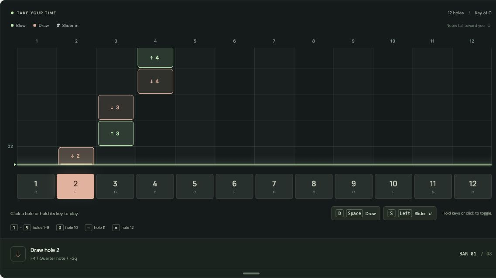
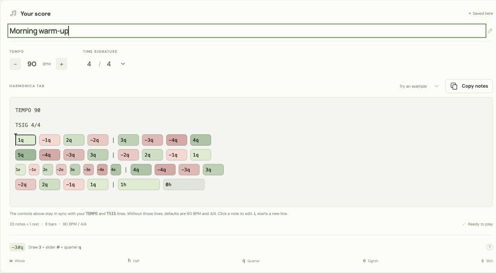
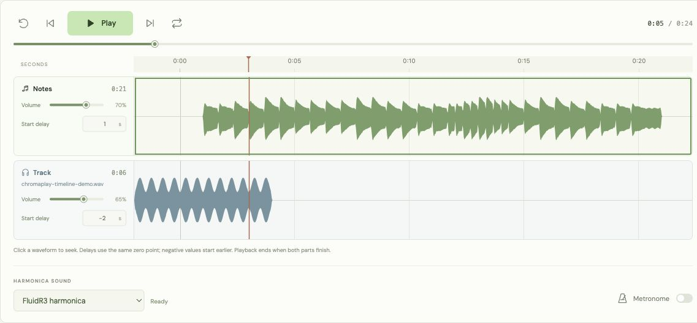
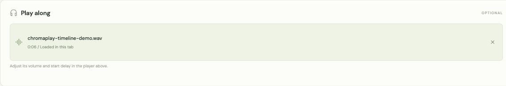

# ChromaPlay

A browser app for practicing a 12-hole chromatic harmonica. Write a melody in simple text, hear it played back, and follow the falling notes. Add your own backing track or play the on-screen harmonica with your mouse and keyboard.

**[Open ChromaPlay](https://alirezaroshanzamir.github.io/chromaplay/)**



Follow the falling notes or play the harmonica directly with your mouse and keyboard.

## Features

- A simple notation language for holes, blow/draw, the slider, note lengths, and rests.
- An inline score editor with duration-sized note boxes, breath colors, and a moving playhead.
- A falling-note visualizer across all 12 holes, with adjustable height and labels for short notes.
- Tempo and time signature controls in the score panel, synced with text headers, plus a metronome, looping, seeking, and note-by-note navigation.
- Three sounds: synthesized reed, FluidR3 harmonica, and recorded VCSL chromatic harmonica.
- A playable harmonica with mouse, touch, and keyboard controls.
- Notes and backing track waveforms on one timeline, with separate volume and start delay controls.
- Local backing tracks that can play alongside a score or on their own.
- Plain-text copying, score import/export, and browser autosave.

ChromaPlay is a static HTML, CSS, and JavaScript app. It has no application backend, account system, or third-party JavaScript dependencies.

## Getting started

Open the [live app](https://alirezaroshanzamir.github.io/chromaplay/), try the included warm-up, and press **Play**. To write your own score:

1. Choose **Blank score** from the example menu, or edit the existing notes.
2. Enter notation such as `1q -1q 2q -2q | 3h 0h`.
3. Set the tempo and time signature with the score panel controls, or write `TEMPO 90` and `TSIG 4/4` on their own lines at the top. The controls and headers stay in sync. Without headers, the score uses 60 BPM and 4/4.
4. Choose a sound, press **Play**, and follow the notes. Add a backing track if you want to play along.

Editing notation or changing the score's timing controls pauses playback and returns to the beginning. Invalid notation is highlighted and must be fixed before playback or export.

### Run locally

Use Node.js 24 and npm. There are no packages to install.

```sh
git clone https://github.com/AlirezaRoshanzamir/chromaplay.git
cd chromaplay
npm run dev
```

Open [http://127.0.0.1:5173](http://127.0.0.1:5173). The local server serves static files only. Use HTTP rather than opening `index.html` directly, because browsers can block JavaScript modules loaded from a file URL.

## Writing notes

Start a score with optional tempo and time signature headers:

```text
TEMPO 90
TSIG 4/4
1q -1q 2q -2q | 3h 0h
```

Keep each header on its own line before the notes. Either header may be omitted; defaults are `TEMPO 60` and `TSIG 4/4`. `TEMP` is also accepted as an alias for `TEMPO`. The score panel's tempo and time signature controls update these headers, and editing a header updates its control. These settings stay in copied and exported notation.

Each note has this form:

```text
[breath]hole[slider]duration[dot]
```

Brackets indicate optional parts; do not type them.

| Part | Meaning | Example |
| --- | --- | --- |
| Breath | No sign or `+` for blow; `-` for draw | `3q`, `+3q`, `-3q` |
| Hole | `1` through `12` | `12h` |
| Slider | `#` after the hole presses the slider | `-3#q` |
| Duration | Required lowercase letter from the table below | `1w` |
| Dot | A final `.` adds half the duration | `1q.` |
| Rest | `0` followed by a duration | `0h` |

For example, `-3#w` means draw hole 3 with the slider pressed for a whole note. A rest cannot have a breath sign or slider.

| Duration | Length | Quarter-note beats |
| --- | --- | --- |
| `w` | Whole | 4 |
| `h` | Half | 2 |
| `q` | Quarter | 1 |
| `e` | Eighth | 0.5 |
| `s` | Sixteenth | 0.25 |

A dotted quarter note (`1q.`) lasts 1.5 quarter-note beats. Dots also work with rests: `0q.`.

### Spacing and line breaks

Within the notes, spaces, tabs, newlines, and `|` do not affect playback, even when placed inside a note. Tempo and time signature headers need their own lines. These note examples sound the same:

```text
1q -1q 2q -2q | 3h 0h
1q-1q2q-2q3h0h
1 q - 1 q 2 q - 2 q | 3 h 0 h
```

Use `|` as a visual separator. It does not add time or enforce a bar boundary.

Uppercase `L` ends a line in the editor:

```text
1q -1q 2q -2q L 3h 0h
```

This displays two rows. Put `L` between complete notes, not inside a note. When a score contains `L`, each row stays together and long rows scroll sideways. Enter still inserts a normal line break. Consecutive `L` markers create blank lines. The markers add no time or sound and stay in copied, saved, and exported text. Click an `L` badge to select it for replacement or deletion.

### Editing note boxes

Completed notes become compact, rounded boxes in the editor. Space, Enter, Tab, or leaving the editor finishes a note. Click a box to edit its original text. Plain-text copy/paste and undo/redo work in the editor; **Copy notes** copies the entire score.

Box width follows duration: a whole note is twice as wide as a half note, and a dot adds 50%. Widths adjust so four whole notes and their usual separators fit on one line. Very short boxes may shorten their labels; hover or click to read the full note.

Blow notes are green, draw notes are red, and higher hole numbers use darker shades. Rests are gray. During playback, a vertical playhead moves through the boxes and the editor scrolls to the current note.



Click a note box to edit its text. Use `L` to keep a phrase on its own row.

## Playing the harmonica

Click or tap a hole to hear it. Hold the mouse button or a hole key to sustain a note. The default is blow with the slider out.

| Control | Action |
| --- | --- |
| `1` through `9` | Play holes 1-9 |
| `0` | Play hole 10 |
| `-` | Play hole 11 |
| `=` | Play hole 12 |
| Hold `D` or Space | Draw |
| Hold `S` or Left Arrow | Press the slider |
| Enter while a hole is focused | Play that hole |
| Draw / Slider buttons | Toggle the corresponding mode |

Combine draw and slider with any hole key or mouse-held note. If both keys for a mode are held, the mode stays active until both are released. A button toggle stays active until you switch it off.

When several hole keys are held, the last one pressed sounds. Releasing it returns to the previous held key. Number-pad digits also work. The mapping uses physical keyboard key positions.

These shortcuts stay inactive while typing in the editor or other fields, or while the notation guide is open. They do not override Ctrl/Command or Alt shortcuts. Leaving the tab or window stops a held note.

Manual playing works with an empty score and uses the **Notes** volume setting. It pauses score playback while keeping the current position.

### Tuning and sound

The instrument uses standard C solo tuning, following the [HOHNER tuning chart](https://hohner.de/fileadmin/documents/instruments/harmonicas/2025_tuning_chart.pdf). Blow notes run from C4 to C7. The slider normally raises pitch by one semitone. The standard top-hole exception is draw hole 12 with the slider pressed (`-12#q`), which sounds D7.

The `#` symbol means press the slider; it is not a written pitch accidental.

FluidR3 harmonica is the default sound. Saved scores keep their selected sound. Use the sound menu to choose the tone for score playback and manually played holes:

| Sound | Source |
| --- | --- |
| Synthesized reed | ChromaPlay's original tone, generated with Web Audio |
| FluidR3 harmonica | Sampled General MIDI harmonica from FluidR3 |
| VCSL chromatic harmonica | Normal sustain recordings of a Hohner Super64 chromatic harmonica |

The two sample sets are bundled with the app and load when selected. They use recorded anchor pitches and adjust playback speed for notes between them. Sustain loops let a note play for its full written duration or as long as you hold a hole. These recordings provide a tone for each pitch, rather than a separate recording for every hole, breath, and slider combination.

The selected sound autosaves and is included in exported projects. Sample loading needs no CDN or third-party JavaScript library. See [sound credits and licenses](CREDITS.md) for the recording sources, FluidR3 attribution, and VCSL's CC0 license.

## Tempo and playback

Use the tempo minus/plus buttons or BPM field and the time signature controls in the score panel. You can also write `TEMPO number` and `TSIG numerator/denominator` at the top of the score, before any notes. Changing a control updates its header; editing a header updates the controls.

The headers can appear in either order, with one setting per line. Duplicate settings and headers placed after notes are reported as errors. `TEMP` is accepted as a shorter spelling of `TEMPO`.

```text
TEMPO 70
TSIG 6/8
1q. 2e 3e 2e | -1q. -2q.
```

Tempo defaults to **60 BPM**, accepts whole numbers from **30-300**, and always counts quarter notes, including in `6/8`. At 60 BPM, a quarter note lasts one second and an eighth note lasts half a second.

The time signature defaults to **4/4**. It accepts a numerator of **1-32** and a denominator of **2, 4, 8, or 16**. It controls visual bar lines and metronome pulses and accents without changing written note lengths. A `6/8` bar contains three quarter-note beats and six eighth-note metronome pulses.

Tempo and meter are part of the score. Changing either with its control or header pauses playback and returns to the beginning. Removing a header restores that setting's default in the controls. Older saved projects keep their timing: ChromaPlay adds their existing tempo and time signature as score headers when first opening them.

Use **Previous** and **Next** to move through notes and rests, **Restart** to return to the beginning, or the timeline to seek. **Pause** pauses both notes and backing audio. Playback continues until the shifted score and backing track have both finished, and **Loop** repeats that full timeline. A backing track can play on its own when the score is empty.

The falling-note visualizer follows the score's position within the shared timeline. It continues through any time before the notes begin or after they finish while the backing track plays. The metronome starts with the delayed score and stops when the score ends, even if the backing track continues.

Right Arrow moves to the next note and Home restarts when focus is outside the editor, inputs, buttons, and other controls, and the guide is closed. Space is the draw modifier, not a playback shortcut.

### Adjusting the visualizer

Drag the horizontal handle at the bottom of the visualization card up or down to resize the visualizer from **180 to 640 pixels** tall. ChromaPlay remembers this display preference in your browser, separately from the score.

Short notes keep their hole and slider labels, using a smaller font when needed. The visible time window adjusts with the visualizer height to keep those notes readable.

### Waveforms, volume, and start delays



The player shows a **Notes** waveform and, when you load a backing file, a **Track** waveform. Both use the same time scale and playhead. The track waveform comes from the uploaded audio; the notes waveform previews the amplitude of the written melody with the selected harmonica sound.

Each row has a volume slider with a percentage and its own **Start delay** in seconds. Volumes range from **0% to 100%**. Set either one to **0%** to mute it, or both to **0%** for silent visual practice. Raising the slider restores its sound. You can adjust either volume during playback without moving the playhead.

The Notes slider also controls the metronome and manually played holes. Volumes autosave with the score and are included in exported projects. A muted part in an older saved score opens at 0%, so its state is visible and you can restore it with the slider.

Start delays range from **-600 to 600 seconds**, including fractions, and both default to **0**. They are measured from the same timeline zero, rather than from each other:

| Notes delay | Track delay | Result |
| --- | --- | --- |
| `0` | `0` | Notes and track start together |
| `0` | `-2` | Track starts two seconds before the notes |
| `3` | `0` | Notes start three seconds after the track |
| `-2` | `1` | Notes start three seconds before the track |

Negative delays extend the timeline before zero, so **Play** from the beginning and **Restart** include that lead-in. Pause, resume, and seeking keep both waveforms aligned. The full timeline extends to whichever part finishes last. Both delays autosave and are included in exported projects; older projects start the notes at zero and keep their existing track delay.

## Backing tracks

Choose a local audio file or drop it on the upload area. Supported formats depend on your browser; MP3 and WAV are good starting points. Files can be up to **100 MB**.

Loading a file adds its waveform and Track controls to the player. Adjust its volume and start delay there to match the score. The audio file plays at its original speed; changing the score tempo does not stretch the track.



Choose a track from your device and adjust its timing to match the score.

## Saving and privacy

The current score and settings autosave to this browser's local storage, including unfinished notation. Storage belongs to the browser and site address. Clearing browser data removes it, and scores saved at another ChromaPlay address do not appear here automatically. Use export/import to move them.

- **Export score** downloads a version 3 `.chroma.json` file with the title, notation and its tempo/meter headers, sound choice, both start delays, volumes, metronome, and loop settings.
- **Import** accepts `.json` and `.chroma` projects, or `.txt` notation. Text imports keep tempo/meter headers, use defaults for omitted settings, and use the filename as the title. Version 1 and 2 projects are migrated to the current format automatically, preserving their notes, selected sound, volumes, and existing track delay.
- Imports validate notation and settings before replacing the score. Score files are limited to **1 MB**, and notation to **100,000 characters**.

Backing audio stays in the current tab. It is not saved in local storage or included in an exported score. Select the file again after reloading the app or opening a score in another tab.

ChromaPlay does not upload your score or selected audio files. The stylesheet loads fonts from Google Fonts, and the site host receives normal page and asset requests. The app has no analytics code.

## Development

Use Node.js 24. Tests use Node's built-in test runner, and the build script copies the browser files into `dist/`.

```sh
npm test
npm run build
```

| File | Purpose |
| --- | --- |
| `app.js` | Interface, project state, and playback controls |
| `notation.js` | Notation parser and pitch mapping |
| `note-editor.js` | Inline editing and score playhead |
| `note-style.js` | Note colors and duration widths |
| `audio.js` | Web Audio synthesis, sampled instruments, and synchronized playback |
| `instrument.js`, `assets/sounds/` | Bundled harmonica recordings, loading, pitch mapping, and sample licenses |
| `tools/prepare-samples.py` | Optional script for rebuilding the bundled recordings |
| `manual-play.js` | Mouse, touch, and keyboard instrument controls |
| `visualizer.js` | Falling-note canvas display |
| `timeline.js` | Shared playback bounds and independent clip delays |
| `waveform.js` | Cached audio previews, ruler, playhead, and waveform seeking |
| `project.js` | Project validation, import, and export |
| `index.html`, `styles.css` | Page structure and styling |
| `*.test.js` | Automated tests |
| `scripts/` | Local server and static build scripts |

### GitHub Pages deployment

The [Deploy to GitHub Pages workflow](.github/workflows/pages.yml) runs tests and builds the app on pushes to `main` and pull requests. Successful pushes to `main` deploy `dist/` to GitHub Pages automatically. You can also run the workflow manually from the repository's **Actions** tab; deployment is restricted to `main`.

In repository **Settings > Pages**, the build source must be **GitHub Actions**. The workflow uses GitHub's built-in token and Pages environment; no deployment secret or application server is needed.

To host ChromaPlay elsewhere, run `npm run build` and serve the contents of `dist/` with a static HTTP host. Asset paths are relative, so the app can also live under a subdirectory.

## Contributing

Bug reports, ideas, and pull requests are welcome. [Open an issue](https://github.com/AlirezaRoshanzamir/chromaplay/issues) with your browser, steps to reproduce, and a short notation example when relevant. Please avoid attaching private scores or audio you do not want to share publicly.

Before sending a pull request, run `npm test` and `npm run build`. For interface changes, also try the app in a browser at desktop and mobile widths.
